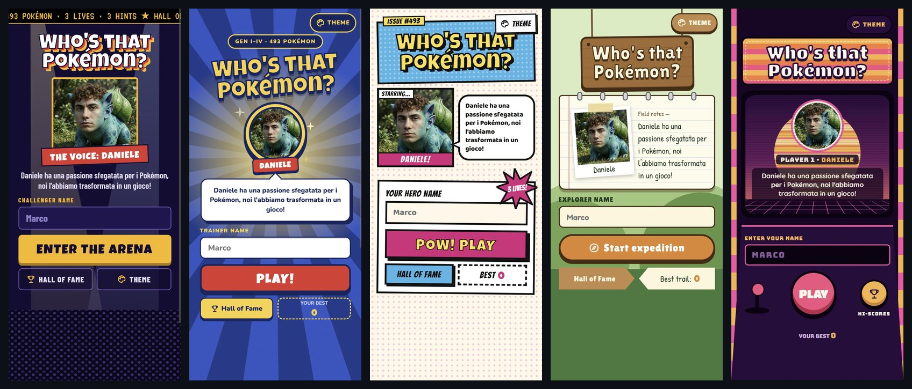
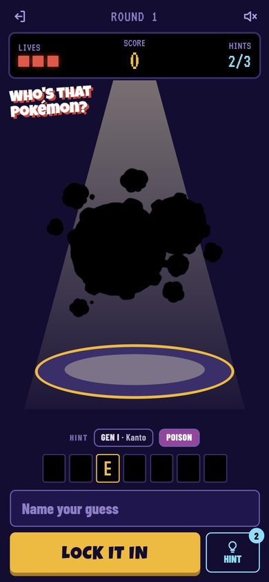
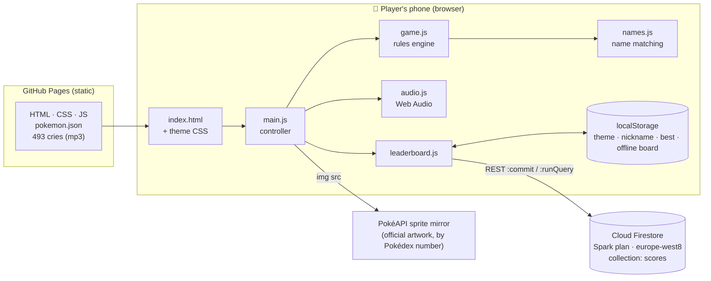
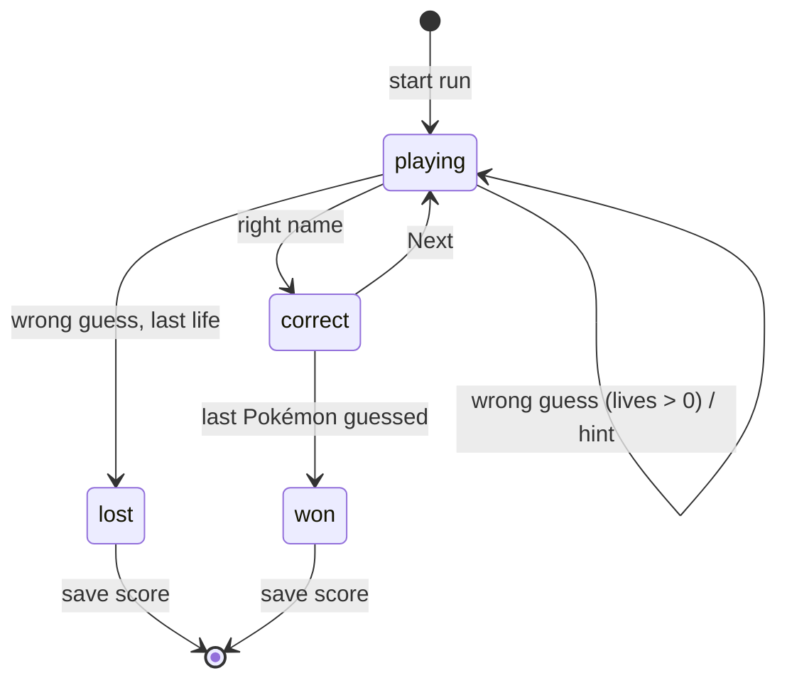
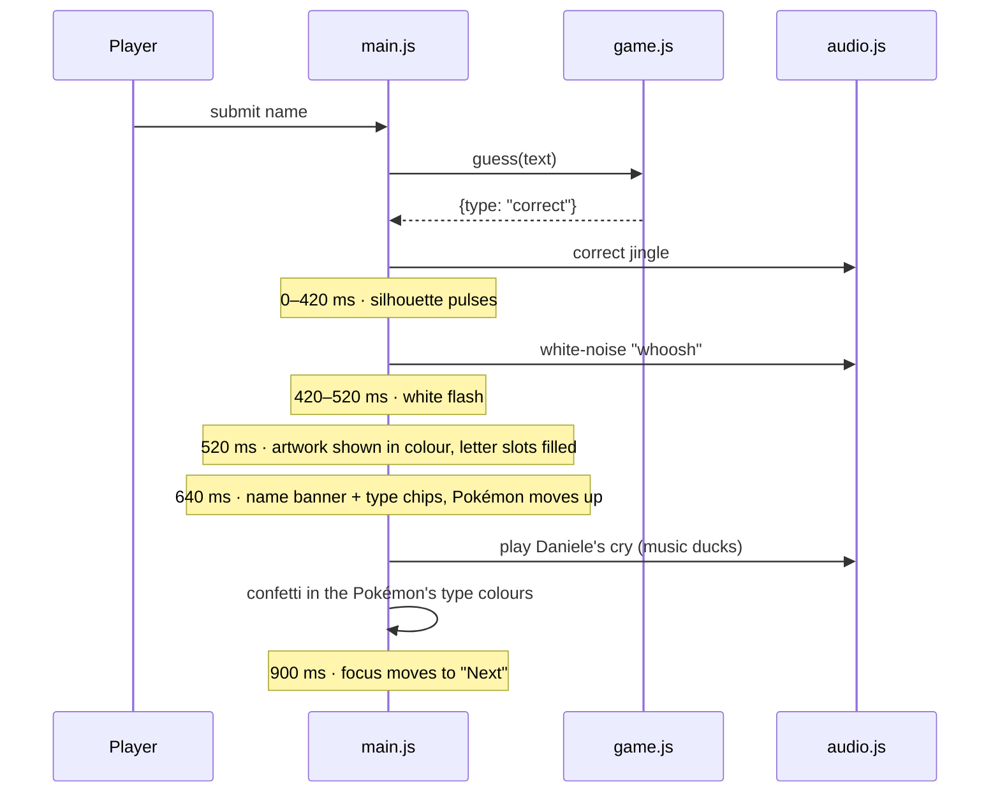
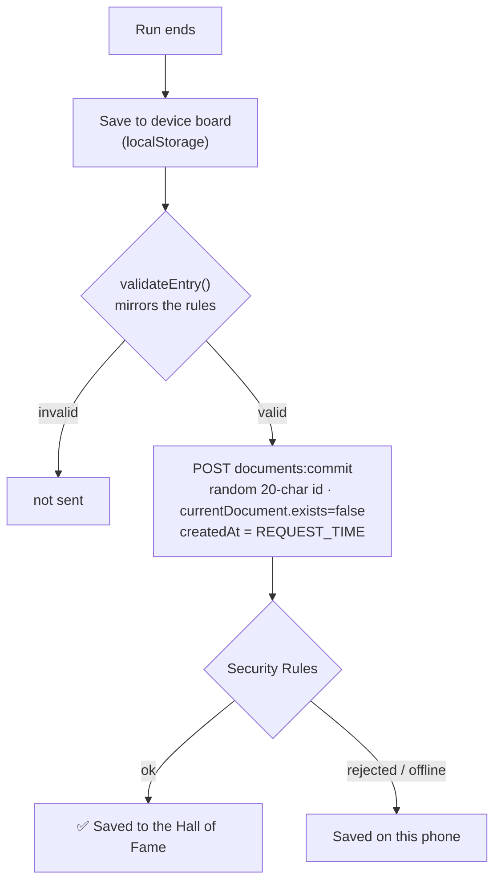

# 🎙️ Who's That Pokémon? — Voice-Acted Silhouette Game

[](LICENSE)
[](https://github.com/FerdinandoConte/whos-that-pokemon/actions/workflows/tests.yml)


> A mobile-first web game inspired by the classic anime segment: a Pokémon appears as a black silhouette, you type its name, and when you get it right it is revealed with confetti — and its cry, **voice-acted by a friend, Daniele, for all 493 Pokémon of Generations I–IV**.

**▶ Play:** https://ferdinandoconte.github.io/whos-that-pokemon/

**Author:** [Ferdinando Conte](https://github.com/FerdinandoConte)



<p align="center"></p>

---

## 📌 Overview

The game was built as a gift for Daniele, a lifelong Pokémon fan who recorded a cry for every one of the 493 Pokémon from Kanto to Sinnoh with his phone. The project turns those raw recordings into a polished, replayable game that friends can open from a link on their phones, compete on a shared Hall of Fame, and share their streak.

Three constraints shaped every technical decision:

| Constraint | Consequence |
|---|---|
| **€0 to run, forever** | Static site on GitHub Pages; leaderboard on Firestore's free Spark plan (no billing account attached); no server, no build step, no paid APIs |
| **Played almost only on phones** | Mobile-first layouts, on-screen-keyboard-aware viewport, ≥16 px inputs (no iOS zoom), 44 px touch targets, iOS audio unlocking |
| **Tiny audience, zero maintenance** | No framework, no dependencies at runtime, no backend code to patch; everything is plain HTML/CSS/ES modules |

---

## ✨ Key Features

| Feature | Description |
|---|---|
| **493 Pokémon, Gen I–IV** | Every run is a fresh cryptographically-random permutation (`crypto.getRandomValues` + Fisher–Yates): no repeats within a run, different order every run |
| **Voice-acted cries** | All 493 cries recorded by Daniele, cleaned by a dedicated audio pipeline (trim, denoise, declip, loudness normalisation) |
| **3 lives per run** | Any wrong name costs a life — including names that don't exist. Case, spaces and punctuation are ignored (`mr mime` = *Mr. Mime*) |
| **3 hints per run** | A hint reveals one hidden letter **plus** the generation (and region) **plus** the type(s). The name's length is always visible |
| **Reveal sequence** | ~1.5 s choreography: silhouette pulse → white flash → full-colour artwork → name banner → confetti in the Pokémon's type colours → Daniele's cry |
| **5 themes, 5 layouts** | Night Arena (default), TV Burst, Comic Pop, Wild Forest, Ember Arcade — each with its own layout, typography and animated background; gameplay is identical |
| **Online Hall of Fame** | Nickname-based top-20 on Firestore, protected by server-side validation rules; scores are also kept on the device when offline |
| **Original soundtrack & SFX** | A chiptune loop and all sound effects are synthesised at runtime with the Web Audio API (no copyrighted audio) |
| **Share** | Native share sheet on phones, clipboard fallback elsewhere |
| **Debug overlay** | Append `?debug=1` to the URL to see the answer, state, audio status, viewport and errors live on a real phone |
| **Accessible** | Real buttons and labels, `aria-live` announcements, `prefers-reduced-motion` support |

### Themes

| Theme | Concept |
|---|---|
| **Night Arena** *(default)* | Stadium at night: sweeping spotlights, LED scoreboard, scrolling ticker, crowd |
| **TV Burst** | The anime segment: rotating blue/yellow rays, chunky cartoon UI |
| **Comic Pop** | Halftone paper, ink outlines, panels and speech bubbles |
| **Wild Forest** | Field expedition: wooden signs, field notebook, binocular view through swaying grass |
| **Ember Arcade** | Neon cabinet at sunset: striped CRT sun, moving synthwave grid, round arcade buttons |

---

## 🏗️ Architecture

### System overview



There is **no backend code**. The browser downloads static files from GitHub Pages, loads artwork from the public PokéAPI sprite mirror, and talks directly to Firestore's REST API. All trust decisions that matter (what a valid score looks like, that nobody can edit or delete scores) are enforced server-side by Firestore Security Rules.

### Repository layout

```
whos-that-pokemon/
├── index.html                  # Single page; applies the saved theme before first paint
├── manifest.webmanifest        # "Add to Home screen" support
├── .nojekyll                   # Serve files as-is on GitHub Pages (no Jekyll build)
├── firestore.rules             # Server-side validation for the Hall of Fame
├── LICENSE · NOTICE            # MIT for the code; rights for recordings, photo, trademarks
│
├── css/
│   ├── app.css                 # Shared foundation: silhouette, reveal, slots, sheets, animations
│   └── themes/                 # One file per theme: layout, typography, animated backgrounds
│       ├── arena.css  burst.css  comic.css  forest.css  arcade.css
│
├── js/
│   ├── main.js                 # Controller: screens, sheets, reveal choreography, wiring
│   ├── game.js                 # Pure rules engine (lives, hints, score, random order)
│   ├── names.js                # Normalisation & matching of typed names; letter slots
│   ├── leaderboard.js          # Firestore REST client + device fallback + validation
│   ├── audio.js                # Cries, synthesised SFX, chiptune loop, iOS unlock
│   ├── confetti.js             # Canvas confetti (no library)
│   ├── viewport.js             # Visual-viewport tracking for the on-screen keyboard
│   ├── storage.js              # localStorage with in-memory fallback (private mode)
│   ├── debug.js                # ?debug=1 overlay (lazy-loaded)
│   ├── config.js               # Firebase project, artwork & fallback-cry sources
│   └── themes/                 # One template module per theme + shared parts
│       ├── index.js            # Theme registry, default theme, required hooks contract
│       ├── parts.js            # Shared markup (form, slots, reveal panel, icons, type colours)
│       ├── arena.js  burst.js  comic.js  forest.js  arcade.js
│
├── data/pokemon.json           # 493 entries: id, name, types, generation, cry flag
├── audio/cries/<id>.mp3        # Daniele's cleaned cries (mono, 44.1 kHz, 80 kbps)
├── img/                        # Daniele's photo, app icons
│
├── docs/screenshots/           # README images, captured from the live site
│
├── tools/
│   ├── clean_audio.py          # Audio-cleaning pipeline (NumPy/SciPy + ffmpeg)
│   ├── audio_report.json       # Before/after measurements for every cry
│   └── pokemon_source.txt      # Source table for data/pokemon.json
│
├── tests/
│   ├── unit/                   # Rules, names, data integrity, leaderboard (node:test)
│   ├── audio/                  # Independent ffmpeg re-measurement of every cry
│   ├── e2e/                    # Playwright, phone emulation, every theme
│   └── run-all.mjs             # Runs everything, writes test-results/REPORT.md
│
└── .github/workflows/tests.yml # CI: full suite on every push
```

### Separation of concerns

The design keeps **rules**, **presentation** and **I/O** in separate modules so that each can be tested on its own:

- **`game.js` is pure.** It knows nothing about the DOM. `createGame(pokedex)` returns an object with `guess()`, `useHint()`, `next()` and `snapshot()`. Every rule of the game is unit-tested in Node, including a full 493-round run.
- **Themes are templates, not logic.** Each theme module exports `home()` and `game()` returning markup. Elements the controller needs carry `data-role` hooks (`guess-input`, `hint`, `lives`, `stage`, …). `themes/index.js` declares the **required hooks contract**, and the end-to-end suite verifies that every theme honours it — which is how five completely different layouts are guaranteed to behave identically.
- **`main.js` is the only module that touches the DOM.** It renders the active theme, binds events to `data-role` hooks, and runs the reveal choreography.
- **I/O is isolated.** Audio (`audio.js`), persistence (`storage.js`) and the network (`leaderboard.js`) sit behind small interfaces; the leaderboard takes `fetch` as a parameter so it can be tested with mocks.

### Game state machine



Lives and hints are **per run** (3 each), not per Pokémon. Revealed letters reset for every Pokémon. A refused hint (none left, or only one hidden letter left) is never consumed — hints never reveal the whole name.

### Name matching

Typed names are normalised before comparison (`names.js`): Unicode NFKD, accents stripped, lower-cased, `♀ → f`, `♂ → m`, every non-alphanumeric character removed. This makes the rule "*exact name, ignoring case and symbols*" precise:

| Typed | Matches |
|---|---|
| `mr mime`, `MR. MIME`, `Mr-Mime` | Mr. Mime |
| `farfetchd`, `Farfetch’d` (iOS curly apostrophe) | Farfetch'd |
| `ho oh`, `porygon z`, `mime jr` | Ho-Oh, Porygon-Z, Mime Jr. |
| `nidoran f`, `nidoran m`, `nidoran` | Nidoran♀ / Nidoran♂ (♀/♂ can't be typed on most phone keyboards) |
| `Pikachuu`, `Pika`, `Raichu` | ✗ — no fuzzy matching, typos cost a life |

The test suite proves that normalised names are unique across the Pokédex and that **every Pokémon rejects every other Pokémon's name** (493 × 492 checks).

### Reveal choreography



The silhouette is the official artwork rendered with `filter: brightness(0)`; the image URL uses the Pokédex number, so the answer can't be read from the page. The artwork is loaded from a public mirror with an automatic fallback to a second CDN; if both fail, a "?" placeholder keeps the game playable. The next two Pokémon are preloaded (images and cries) — and only those, to respect mobile data.

### Audio engine

- **Cries** are fetched once, decoded with `AudioContext.decodeAudioData` and played as `AudioBufferSourceNode`s. Web Audio (unlike `<audio>`) can start a sound after the tap that unlocked it, which is what the ~600 ms reveal delay requires on iPhone. If a recording can't be loaded, the official cry is played instead.
- **iOS specifics:** the context is created and resumed inside the "Play" tap, a 1-sample buffer is played to unlock output, and `navigator.audioSession.type = 'playback'` (iOS 17+) lets sound play even with the silent switch on. Audio is suspended when the tab is hidden.
- **Music & SFX** are synthesised: a 128 BPM chiptune loop (square lead, triangle bass and arpeggio) scheduled with a look-ahead timer, and effects built from oscillators and filtered noise. The music automatically ducks under each cry.

### Hall of Fame (Firestore)



- The client talks to Firestore through its **REST API** — no SDK to download, no dependency to keep updated.
- Each score is a **new document with a random id** written through a `commit` with the precondition `exists: false`, and `createdAt` is set by the server (`REQUEST_TIME`).
- **Security Rules** ([`firestore.rules`](firestore.rules)) allow reading the board, allow *creating* a score only if it has exactly the expected fields and types, a 1–16 character name, `0 ≤ score ≤ 493`, `0 ≤ hints ≤ 3`, and a server timestamp; **updates and deletes are always refused**, and every other path in the database is closed.
- `validateEntry()` in `leaderboard.js` mirrors those rules exactly, and a unit test parses `firestore.rules` to make sure the limits never drift apart.
- The rules were also verified **against the live project**: a valid score is accepted (200), while a score of 999, a 20-character name, an extra field, 4 hints, an overwrite, a delete and access to any other collection are all rejected (403).
- The Firebase web `apiKey` in `js/config.js` is a public identifier, not a secret: access is governed entirely by the rules above.

> **Honest limitation:** with no login, a determined user could post an inflated but *plausible* score (e.g. 120) by calling the API directly. For a game among friends this is an accepted trade-off; preventing it would require authentication and server-side game sessions, i.e. a backend.

### Mobile engineering

- **On-screen keyboard:** `viewport.js` follows `window.visualViewport` and sizes the app to the *visible* area. When the keyboard opens, each theme switches to a compact layout (decorations hidden, controls on one row) so the silhouette, letter slots and input all stay visible — verified by an e2e test at a 390×420 visible area.
- **No iOS zoom:** every input uses ≥16 px text; `autocorrect`, `autocapitalize` and `spellcheck` are off on the guess field so the keyboard never "fixes" a Pokémon name.
- **Safe areas & notches:** `viewport-fit=cover` with `env(safe-area-inset-*)` padding.
- **Theme without flash:** an inline script applies the saved theme before first paint.
- **Small screens:** tested down to 320×568 (iPhone SE 1st gen) for every theme; on larger screens the game stays a centred phone-width column.

### Audio-cleaning pipeline

The raw recordings came from a phone: variable dead air before the cry (up to ~1.1 s), background hiss, levels ranging from −32 to −8 LUFS, and in 63 files digital clipping. [`tools/clean_audio.py`](tools/clean_audio.py) processes each file:

| Step | Technique |
|---|---|
| 1. Declip | Files with > 5 samples at full scale are rebuilt with ffmpeg `adeclip` |
| 2. Rumble | 4th-order Butterworth high-pass at 80 Hz (zero-phase) |
| 3. Denoise | Spectral gating: noise profile from the quietest 15 % of STFT frames, soft mask with a floor (avoids "musical noise"), 3×3 smoothing |
| 4. Trim | Adaptive activity threshold on 20 ms RMS frames; isolated blips and separate much-quieter sounds at the edges (breaths, rustles) are dropped; 30 ms pre-roll / 120 ms post-roll kept |
| 5. Fades | 8 ms fade-in, 60 ms fade-out (no clicks) |
| 6. Loudness | Gentle compression, then iterative gain + true-peak limiter to **−16 LUFS / −1 dBTP** |
| 7. Encode | mp3 mono 44.1 kHz 80 kbps |

Every file's before/after measurements are stored in [`tools/audio_report.json`](tools/audio_report.json). Results across the 493 cries:

| Metric | Before | After |
|---|---|---|
| Average silence before the cry | 0.43 s | **0.05 s** |
| Loudness range across files | −32 … −8 LUFS | **−16.9 … −16.1 LUFS** |
| Share of the cry's energy kept by trimming | — | **≥ 99.2 %** in every file |
| Total size | 17 MB (48 kHz) | **7.0 MB** |

### Data

`data/pokemon.json` holds, for each of the 493 Pokémon, the official English name, current-generation types (including Fairy), generation, a fallback-cry identifier and whether Daniele's recording exists. Types were cross-checked against the [PokéAPI](https://pokeapi.co/) type lists; the unit tests assert the per-type counts from that cross-check.

---

## 🧪 Testing

```bash
node tests/run-all.mjs            # everything
node tests/run-all.mjs unit       # one group: unit | audio | e2e
```

The runner writes a readable report to `test-results/REPORT.md` (every test with result and duration, plus message and stack for failures), the full output to `test-results/<group>.log`, and JUnit XML for tooling. The same suite runs in GitHub Actions on every push.

| Group | Tests | What it covers |
|---|---|---|
| **unit** | 51 | Name normalisation and matching for all 493 names (incl. 493×492 cross-rejections); lives, hints and scoring rules; random-order quality (no repeats in a full run, unbiased first pick across 4 000 runs, 300 distinct sequences); data integrity (ids, names, types, generations, files); leaderboard validation, REST payloads, error handling, and parity with `firestore.rules` |
| **audio** | 5 | Independent re-measurement with ffmpeg of every cry: format, duration, size, loudness within ±1.5 LU of target, peak below 0 dBFS, no leading silence, cleanup kept ≥ 99 % of each cry |
| **e2e** | 73 | Real Chromium with phone emulation (iPhone 13, Pixel 7, iPhone SE, desktop), **every gameplay test repeated on all 5 themes**: home screen, nickname validation, layout overflow and tap-target sizes, silhouette not leaking the answer, wrong/empty guesses, hints, reveal + confetti + cry, game over, quit, keyboard-open layout, theme picker and persistence, artwork CDN fallback, preloading, online and offline Hall of Fame, sharing, accessibility basics, page weight |

External services (artwork, fonts, Firestore) are intercepted in the e2e suite, so tests are deterministic and never write to the real Hall of Fame. Screenshots of every theme and state can be generated with `node tests/e2e/shoot.mjs shots`.

**Requirements:** Node 20+, ffmpeg, and Playwright with Chromium (`npm i --no-save playwright && npx playwright install chromium`).

---

## 🚀 Running & Deployment

**Locally** — any static server works:

```bash
npx http-server -c-1 .     # then open http://localhost:8080
```

**Production** — GitHub Pages serves the `main` branch root; a push is a deploy.

**Hall of Fame setup** (already done for the live game):
1. Create a Firebase project on the **Spark** plan (no billing account), Analytics off.
2. Create a Cloud Firestore database (*Standard* edition, production mode).
3. Paste [`firestore.rules`](firestore.rules) into *Firestore → Rules* and publish.
4. Register a web app and copy `projectId` and `apiKey` into [`js/config.js`](js/config.js).

**Adding or replacing cries:** put the original `<pokedex-number>.mp3` files in a folder and run

```bash
python3 tools/clean_audio.py <raw_folder> audio/cries tools/audio_report.json 493
```

then update the `cry` flags in `data/pokemon.json` (the data tests point out any mismatch) and run the tests.

---

## 💶 Cost

| Service | Plan | Cost |
|---|---|---|
| GitHub Pages | Free for public repositories | €0 |
| GitHub Actions (CI) | Free for public repositories | €0 |
| Cloud Firestore | Spark — no billing account attached | €0 |

On the Spark plan Firebase **cannot** charge: if the daily free quota (50 000 reads, 20 000 writes) were ever exceeded, requests would simply be refused until the next day, and the game would keep working with scores saved on the device.

---

## 🙏 Credits

- **Cries:** recorded by **Daniele**, for all 493 Pokémon.
- **Artwork & data:** official artwork served by the [PokéAPI sprites](https://github.com/PokeAPI/sprites) mirror; type data cross-checked with [PokéAPI](https://pokeapi.co/).
- **Fonts:** Google Fonts (Luckiest Guy, Barlow Condensed, VT323, Nunito, Bangers, Baloo 2, Lilita One, Fredoka, Patrick Hand, Titan One, Bungee, Quicksand).
- **Music & sound effects:** original, synthesised at runtime.

---

## ⚖️ License & Disclaimer

The **source code** is released under the [MIT License](LICENSE). The **voice recordings** in `audio/cries/` and the **photo** in `img/` belong to Daniele and are **not** covered by the MIT License; they may not be reused outside this project without permission (see [`NOTICE`](NOTICE)).

This is an unofficial, non-commercial fan project. Pokémon and Pokémon character names are trademarks of Nintendo, Creatures Inc. and GAME FREAK inc. No official artwork or audio is stored in this repository.
